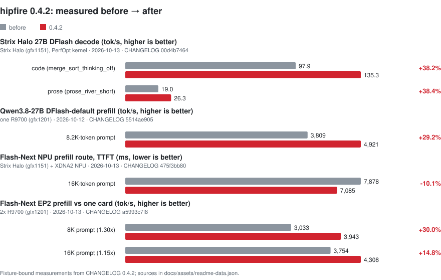

<picture>
  <source media="(prefers-color-scheme: dark)" srcset="docs/assets/hero-dark.png" />
  
</picture>

<h1 align="center">hipfire</h1>

<p align="center">
  <strong>Local LLM inference for AMD GPUs. Tuned first for RDNA, with CDNA support.</strong><br />
  Rust + HIP + Redline. No Python in the hot path. Pull, serve, chat.
</p>

<p align="center">
  <a href="https://github.com/warpfront/hipfire/releases"></a>
  <a href="CHANGELOG.md"></a>
  <a href="docs/MODELS.md"></a>
  <a href="https://discord.gg/F3BaywB8Rs"></a>
</p>

<p align="center">
  <a href="#quickstart">Quickstart</a> ·
  <a href="#whats-new-in-042">What's new</a> ·
  <a href="#models">Models</a> ·
  <a href="#gpu-support">GPU support</a> ·
  <a href="#peacemaker">PeaceMaker</a> ·
  <a href="#install">Install</a> ·
  <a href="#documentation">Docs</a>
</p>

## What hipfire is

hipfire is an inference engine for AMD GPUs. It ships its own Rust runtime,
model implementations, quantization formats (MQ3–MQ6, MQ4R, MFP4), typed
kernel dispatch and HIP kernels. ROCm is loaded dynamically. There is no
Python, PyTorch, CUDA translation layer or third-party inference engine in
the hot path.

You get a curated model registry, a CLI (`pull`, `run`, `chat`, `serve`,
`bench`, `quantize`) and an OpenAI-compatible HTTP daemon. Speculative
decoding (DFlash draft models, native MTP heads), multi-GPU expert
parallelism and the Redline replay path ship with the engine.

## Quickstart

```bash
hipfire pull qwen3.8:27b-mq4-xts
hipfire serve qwen3.8:27b-mq4-xts -d
hipfire chat qwen3.8:27b-mq4-xts
```

This downloads about 15 GB and needs a 24 GB+ card or a Strix Halo system. On
smaller cards, use `qwen3.5:4b` or `qwen3.5:9b` with the same commands.
[Pick a model for your GPU](docs/PICK-A-MODEL.md) lists recommendations for
each GPU tier.

For one-shot inference:

```bash
hipfire run qwen3.8:27b-mq4-xts "What is the capital of France?"
```

Qwen3.8 Flash-Next is a MoE model with about 125 GB of base weights plus
sidecars:

```bash
hipfire pull qwen3.8:flash-next
hipfire serve qwen3.8:flash-next -d
```

A 32 GB card alone is not enough for Flash-Next. It needs a 128 GB Strix Halo
system, or an R9700 with enough host RAM for the mapped experts, or two
R9700s (EP2). Native context is 262K tokens, subject to available memory.

Image generation (RDNA3/3.5 measured):

```bash
hipfire pull flux.schnell:1
hipfire img --out x.png flux.schnell:1 "a red cube on a wooden table"
```

The daemon serves an OpenAI-compatible API on `127.0.0.1:11435`. It listens
on loopback only unless you set `serve.host`.

```bash
curl -s http://127.0.0.1:11435/v1/chat/completions \
  -H "Content-Type: application/json" \
  -d '{"model": "qwen3.8:27b-mq4-xts",
       "messages": [{"role": "user", "content": "What is 2+2?"}],
       "max_tokens": 256,
       "chat_template_kwargs": {"enable_thinking": false}}'
```

Qwen models think by default, and `max_tokens` counts the `<think>` span as
well as the answer. If thinking is on and the cap is small, `content` can come
back empty with `finish_reason: "length"`. Turn thinking off as shown above,
or raise `max_tokens`. Qwen3.8 and Ornith 1.5 default to `medium` reasoning
effort. See [docs/SERVE.md](docs/SERVE.md).

## What's new in 0.4.2

Every figure below comes from the [CHANGELOG](CHANGELOG.md) Unreleased
(0.4.2) entry that introduced the feature. That entry gives the full fixture,
the method and the kill switch. Each figure is a measurement on one fixture,
not a general throughput claim.

<picture>
  <source media="(prefers-color-scheme: dark)" srcset="docs/assets/readme/gains-042-dark.svg" />
  
</picture>

- **Flash-Next EP2.** Owner-routed prefill and long-prefill expert staging
  are on by default when two R9700s (gfx1201) admit EP2. Balanced per-call
  expert ownership and native MTP also run under EP. EP4 owner-routed
  prefill is still refused at admission.
  *Measured on 2x R9700 (gfx1201), pinned Flash-Next XTS, committed prompts,
  2026-10-13: prefill went from 3,033 to 3,943 tok/s at 8K (1.30x) and from
  3,754 to 4,308 tok/s at 16K (1.15x), one card vs EP2.* See
  [multi-GPU serving](docs/multi-gpu.md).
- **Flash-Next NPU prefill route on Strix Halo.** `fusions.npu_trunk = "auto"`
  runs the pipelined trunk input projections on the XDNA2 NPU. It needs
  exact gfx1151, an open NPU and a matching calibration. Any other system
  runs GPU-only. `HIPFIRE_QWEN4_NPU_TRUNK=off` disables it.
  *Measured on gfx1151 + XDNA2, pinned Flash-Next XTS, 16K-token prompt,
  2026-10-13: TTFT went from 7,878 ms to 7,085 ms (−10.1%).*
- **Engine-level YaRN.** The engine now reads YaRN RoPE scaling from the
  checkpoint. `attention.yarn_factor` / `HIPFIRE_YARN_FACTOR` overrides it,
  which lets Flash-Next run past its native 262,144-token context.
  *Measured on gfx1151, Flash-Next GPTQ3 MQ4, `yarn_factor = 4`,
  2026-10-13: a needle placed in a 499,207-token prompt was retrieved at
  10% and at 90% depth.*
- **Halo sidecars (zab and PLE).** On gfx1151, `hipfire pull` fetches the
  Flash-Next zab trunk-A4 overlay, verifies it and applies it by default.
  The q4 PLE sidecar is also on by default there when present.
  `hipfire ple rebind` reuses a q4 PLE payload after the base is repacked.
  See [configuration](docs/CONFIG.md#qwen4-trunk-overlay-sidecar).
- **Strix Halo 27B DFlash.** On exact gfx1151, the 16-row verify GEMMs
  stage activations in LDS (`HIPFIRE_GFX1151_XLDS`, on by default).
  *Measured on Strix Halo (gfx1151), Qwen3.8-27B XTS with the paired DFlash
  draft, committed code prompt, 2026-10-13: decode went from 97.9 to
  135.3 tok/s (+38%). Output is byte-identical.*
- **Qwen3.8-27B DFlash-default prefill.** When the registry-paired draft is
  installed, DFlash is the default, and cold prefill now keeps target
  hidden rows on the device.
  *Measured on one R9700 (gfx1201), Qwen3.8-27B XTS with the paired draft,
  committed 8.2K-token prompt, 2026-10-12: prompt throughput went from
  3,809 to 4,921 tok/s (+29%).* See the
  [paired DFlash default](docs/CONFIG.md#qwen38-27b-paired-dflash-default).
- **MTP draft cap 4 on Halo.** `speculation.mtp_k = auto` resolves to 4 for
  native Flash-Next MTP on gfx1151 and to 3 everywhere else.
  *Measured on gfx1151, pinned Flash-Next XTS, code prompts (Rust/Go/Java),
  2026-10-12: geomean decode went from 67.9 to 70.5 tok/s (+3.8%).*
- **Also in 0.4.2:**
  - a faster Qwen35 MTP prompt fill
  - gfx1201 batched MTP fill for Flash-Next
  - device-side sampled DFlash acceptance
  - continuous-batching sampled-lane batching on gfx1201
  - certified PeaceMaker kernels for CPU-AR sampling
  - symmetric-grid DFlash draft conversion
  - Windows iGPU detection
  - serve queue defaults taken from the config table

  See [CHANGELOG.md](CHANGELOG.md) for the full list.

[BENCHMARKS.md](docs/BENCHMARKS.md) explains fixture identity and the
requirements for admitting a measurement. Its older tables are historical,
not current product baselines.

## Models

The bundled registry (`registry/v1.json`) contains 90 curated entries
(models, quant variants and draft sidecars) and 82 aliases. Run
`hipfire list -r` for the live list.

| Family | Pull tags |
|---|---|
| Qwen 3.8 dense | `qwen3.8:27b` (MQ4V2 default), `qwen3.8:27b-mq4-xts` (flagship), `-mq4-xt`, `-mq4-pro`; MQ3, MQ5 and MQ6 `-xt` / base / `-pro` tiers; drafts `qwen3.8:27b-draft-mq3` … `-mq6` |
| Qwen 3.8 Flash-Next | `qwen3.8:flash-next` (MQ4 XTS) |
| Qwen 3.6 35B-A3B | `qwen3.6:35b-a3b` (MQ4P default), `-mq2`, `-mq3p`, `-mq4p`, `-mfp4`, `-mq4r`, `-mq5`, `-mq6` |
| Qwen 3.6 dense | `qwen3.6:27b`, `qwen3.6:27b-mq3`, drafts `qwen3.6:27b-draft`, `-draft-mq3` |
| Qwen 3.5 dense | `qwen3.5:0.8b`, `2b`, `4b`, `9b`, `27b`, with `-mq3` / `-mq6` variants and `9b` / `27b` drafts |
| Qwen 3.5 MoE | `qwen3.5:35b-a3b` |
| Qwen3 | `qwen3:0.6b`, `qwen3:8b` |
| Muse Glimmer | `muse-glimmer`, `muse-glimmer:fast` (MQ4R), `muse-glimmer:draft` |
| Ornith 1.5 | `ornith-1.5:35b-a3b`, `ornith-1.5:fast` (MQ4R) |
| DeepSeek V4 Flash | `deepseek-v4-flash` |
| MiniMax-M2.7 | `minimax-m2.7` |
| North-Mini-Code-1.0 | `north-mini-code` |
| Carnice (Hermes tool calls) | `carnice:9b`, `carnice:27b`, `-mq6` variants |
| Qwopus | `qwopus:4b`, `9b`, `27b`, `-mq6` variants, `qwopus3.6:27b-coder` |
| LFM2.5 | `lfm2.5:350m`, `1.2b`, `1.2b-thinking`, `8b-a1b` |
| NEX N2 Mini | `nex-n2:mini` |
| VibeThinker | `vibethinker:3b`, `vibethinker:3b-mq6` |
| FLUX (image) | `flux.schnell:1` and others in [IMAGEGEN.md](docs/IMAGEGEN.md) |

Curated weights are published under
[huggingface.co/hipfire-models](https://huggingface.co/hipfire-models).
[docs/MODELS.md](docs/MODELS.md) covers sizes, minimum VRAM, sampling
defaults, sidecars and provenance. To bring your own model, use
`hipfire quantize`.

## GPU support

| Family | Architectures | Notes |
|---|---|---|
| Vega / CDNA | `gfx906`, `gfx908`, `gfx940`–`gfx942` | Wave64 HIP; gfx906 dp4a MMQ prefill; some formats use a per-token GEMV fallback |
| RDNA1 | `gfx1010`–`gfx1013` | Portable HIP and Redline dispatch |
| RDNA2 | `gfx1030`–`gfx1032` | Portable HIP and Redline dispatch |
| RDNA3 | `gfx1100`–`gfx1103` | WMMA kernels, validated MQ4R Redline route |
| RDNA3.5 | `gfx1150`–`gfx1152` | WMMA kernels; Strix Halo (gfx1151) XDNA2 NPU prefill route |
| RDNA4 | `gfx1200`, `gfx1201` | WMMA kernels, retained-PM4 Redline route, EP2 multi-GPU |

<picture>
  <source media="(prefers-color-scheme: dark)" srcset="docs/assets/readme/gpu-matrix-dark.svg" />
  
</picture>

Kernels are chosen through typed per-architecture dispatch tables. A
specialization that is not available falls back to the portable or
architecture fallback kernel. It is never borrowed from a neighbouring GPU
family. Support for a GPU family does not mean every optimized route is
admitted on it.

## Redline

Redline is hipfire's in-tree dispatch and retained-replay layer. It records
the actual kernel graph, derives resource dependencies, retains invariant
command state, and lowers validated paths through public ROCr queue
interfaces. If a graph is unsupported, shadow validation fails, the ABI does
not match, a queue faults or the model changes, Redline falls back to
ordinary HIP dispatch.

<picture>
  <source media="(prefers-color-scheme: dark)" srcset="docs/assets/readme/architecture-dark.svg" />
  
</picture>

The [Golden Redline guide](docs/GOLDEN-REDLINE.md) reproduces the sealed
MQ4R fixture (`python3 -m tools.redline golden`). Historical MQ4R
measurements are in the
[gfx1201 campaign report](docs/perf-checkpoints/2026-07-13-redline-mq4r-110-to-204.md).
For the integration boundary, see
[HIPFIRE-GRAFT.md](crates/redline-dispatch/HIPFIRE-GRAFT.md).

## PeaceMaker

PeaceMaker is hipfire's own kernel toolchain. It builds AMD GPU and XDNA2
NPU programs directly, without hipcc. It works on typed machine code, and it
can lift existing code objects so they can be checked against what
PeaceMaker emits. It has six crates:

| Crate | Role |
|---|---|
| `peacemaker-ir` | Typed RDNA machine-code representation and instruction tables |
| `peacemaker-lift` | Lifter for ELF, offload bundles, descriptors and metadata. Decoded kernels are re-encoded from typed fields and compared word for word |
| `peacemaker-isa` | Kernel builder and emitter (`peacemaker-isa` binary), with region import, wait-ledger checks and certification |
| `peacemaker-author` | PM kernel language (milestone M0, experimental, build-time only) |
| `peacemaker-rip` | Standalone `.rip` front end that lowers Rust-shaped kernel scripts onto the builder, without rustc |
| `peacemaker-npu` | XDNA2 / AIE2P program builder: encoder/scheduler, CDO/PDI and DPU transaction writers, CPU simulator |

In 0.4.2, more production routes run builder-emitted, M7-certified
PeaceMaker kernels. These ship as embedded `kernels/*.hxaco` modules with
shape contracts. The hipcc versions of those kernels are kept only as oracle
twins for exactness tests, not as runtime fallbacks. Examples from the
[CHANGELOG](CHANGELOG.md):

- sampled DFlash device acceptance on gfx1201
- CPU-AR sampled target rows and ordered acceptance on gfx1151 and gfx1201
- Flash-Next EP owner assignment on gfx1201
- the gfx1151 MTP prompt-fill projections

The Strix Halo NPU prefill route builds its programs with `peacemaker-npu`.
The offline `railgun-cert` recording-inventory gate keeps the list of
recording and capture predicates in sync with the source tree. A kernel
route with a certified PeaceMaker kernel is still subject to hipfire's
normal admission and validation gates.

PeaceMaker is also published as a standalone repository,
[github.com/warpfront/peacemaker](https://github.com/warpfront/peacemaker).
`scripts/mirror-push.sh peacemaker` builds a history-preserving split of
the PeaceMaker crates and their path dependencies. It then checks that the
split builds and tests on its own, checks author identities and runs the
publication guard on every commit. Only then does it push to `main`. Like
hipfire, PeaceMaker is Apache-2.0. Some files remain MIT under their
per-file SPDX header, and the mirror's LICENSE adds the LLVM exception
notice (see `scripts/mirror_split.py`).

## Install

Linux with ROCm 6 or newer:

```bash
curl -fsSL https://raw.githubusercontent.com/warpfront/hipfire/master/scripts/install.sh | bash

# Or install the integration branch for testing:
curl -fsSL https://raw.githubusercontent.com/warpfront/hipfire/master/scripts/install.sh \
  | bash -s -- --branch beta
```

RDNA4 requires ROCm 6.4 or newer, and gfx1151 requires ROCm 7.2 or newer.
Release-tag installs download a verified prebuilt kernel pack for the
detected arch when one is available. Otherwise they build kernels locally
with hipcc. See
[Prebuilt kernel packs](docs/GETTING_STARTED.md#prebuilt-kernel-packs).

`hipfire version` compares the installed binary, the managed source checkout
and the daemon. To switch revisions, use `hipfire update @beta`,
`hipfire update --tag <tag>` or `hipfire update --commit <sha>`. To
uninstall while keeping models and settings:

```bash
curl -fsSL https://raw.githubusercontent.com/warpfront/hipfire/master/scripts/uninstall.sh | bash
```

`--dry-run` previews the uninstall. `--purge` also deletes `~/.hipfire` and
asks for confirmation first.

For Windows, source builds and install verification, see
[docs/GETTING_STARTED.md](docs/GETTING_STARTED.md). NixOS has a flake and a
module ([docs/NIXOS.md](docs/NIXOS.md)):

```bash
nix develop github:warpfront/hipfire  # dev shell with Rust + ROCm
nix build github:warpfront/hipfire    # build package
```

Containers ([docs/CONTAINER.md](docs/CONTAINER.md)):

```bash
podman build -f Containerfile --target runtime -t hipfire .
podman run --rm -it --device /dev/kfd --device /dev/dri \
  --group-add keep-groups --security-opt seccomp=unconfined \
  -v hipfire-models:/root/.hipfire/models \
  -v hipfire-kcache:/var/cache/hipfire \
  hipfire run qwen3.5:4b "2+2="
```

## Deprecated features

PFlash prefill compression, CASK / TriAttention KV eviction,
Givens/asymmetric KV modes and the legacy DFlash knobs have been deprecated
since 0.4.0. They are unsupported and will be removed in 0.5.0. See
[configuration](docs/CONFIG.md) for supported settings and
[validation](docs/VALIDATION.md) for the current gates.

## Documentation

| Page | Topic |
|---|---|
| [GETTING_STARTED.md](docs/GETTING_STARTED.md) | Install, first run, what to read next |
| [PICK-A-MODEL.md](docs/PICK-A-MODEL.md) | Model recommendations by GPU tier |
| [CLI.md](docs/CLI.md) | Every subcommand, flags, file locations |
| [MODELS.md](docs/MODELS.md) | Curated tags, BYO models, file extensions |
| [QUANTIZE.md](docs/QUANTIZE.md) | `hipfire quantize` for HF / safetensors |
| [CONFIG.md](docs/CONFIG.md) | Every config key and env override |
| [SERVE.md](docs/SERVE.md) | OpenAI-compatible HTTP API |
| [multi-gpu.md](docs/multi-gpu.md) | EP, TP and pipeline parallelism; budgets and refusals |
| [IMAGEGEN.md](docs/IMAGEGEN.md) | FLUX image generation |
| [ARCHITECTURE.md](docs/ARCHITECTURE.md) | Engine layout and dispatch |
| [QUANTIZATION.md](docs/QUANTIZATION.md) | MQ formats, KV cache modes, FWHT |
| [BENCHMARKS.md](docs/BENCHMARKS.md) | Admitted measurements and claim requirements |
| [VALIDATION.md](docs/VALIDATION.md) | Correctness and speed gates |
| [methodology/perf-benchmarking.md](docs/methodology/perf-benchmarking.md) | Benchmark protocol |
| [peacemaker-isa map](crates/peacemaker-isa/map.md) / [peacemaker-author map](crates/peacemaker-author/map.md) | PeaceMaker builder and kernel language |
| [npu/README.md](docs/npu/README.md) / [peacemaker-npu map](crates/peacemaker-npu/map.md) | XDNA2 NPU builder, simulator and tools |
| [NIXOS.md](docs/NIXOS.md) / [CONTAINER.md](docs/CONTAINER.md) | NixOS and container builds |

## Contributing

See [CONTRIBUTING.md](CONTRIBUTING.md), including the
[release cadence and PR cutoff](CONTRIBUTING.md#release-cadence-and-pr-cutoff).
Install local hooks with `./scripts/install-hooks.sh`.
`./scripts/no-gpu-ci.sh` runs the no-GPU CI subset, but it does not replace
the hardware gates. No single gate establishes correctness on its own.
Choose the route your change needs from
[docs/VALIDATION.md](docs/VALIDATION.md):

- `scripts/serve_harness.py` for generation and state-lifecycle changes.
- `scripts/redline_daemon_harness.py` for kernel, dispatch, graph or replay
  changes.

Do not bypass hooks with `--no-verify`.

Discord: <https://discord.gg/F3BaywB8Rs>

## Acknowledgements

hipfire's gfx906 MMQ prefill path follows the design of the MMQ kernels in
upstream [llama.cpp](https://github.com/ggml-org/llama.cpp). The
community-maintained gfx906 forks of llama.cpp also informed that work.
[CREDITS.md](CREDITS.md) lists contributors.

## License

hipfire is licensed under **Apache-2.0** as of v0.3.0. See
[LICENSE](LICENSE), [LICENSE-APACHE](LICENSE-APACHE) and [NOTICE](NOTICE).
Releases up to and including v0.2.1 were dual MIT/Apache-2.0, and that grant
is not revoked. Files whose authors have not elected Apache-2.0 remain MIT
([LICENSE-MIT](LICENSE-MIT)) and say so in their `SPDX-License-Identifier`.
The decision record is
[docs/governance/relicense-2026-05.md](docs/governance/relicense-2026-05.md).
Architectural work that originated in hipfire is catalogued in
[PRIOR-ART.md](PRIOR-ART.md). Derivative works should attribute it as
described in [AGENTS.md](AGENTS.md).
