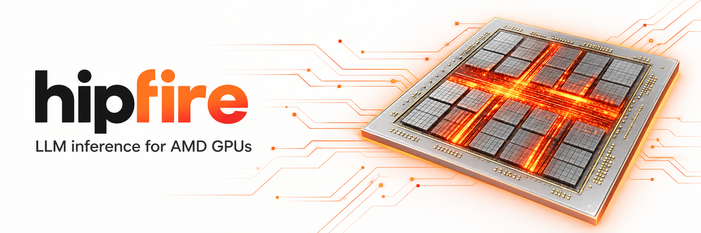
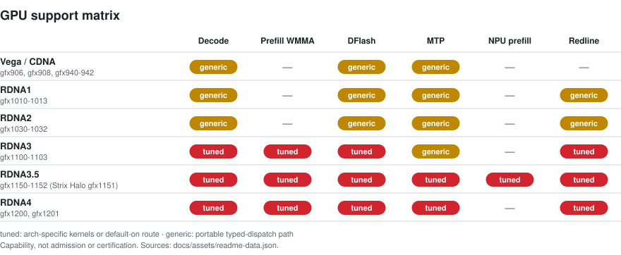
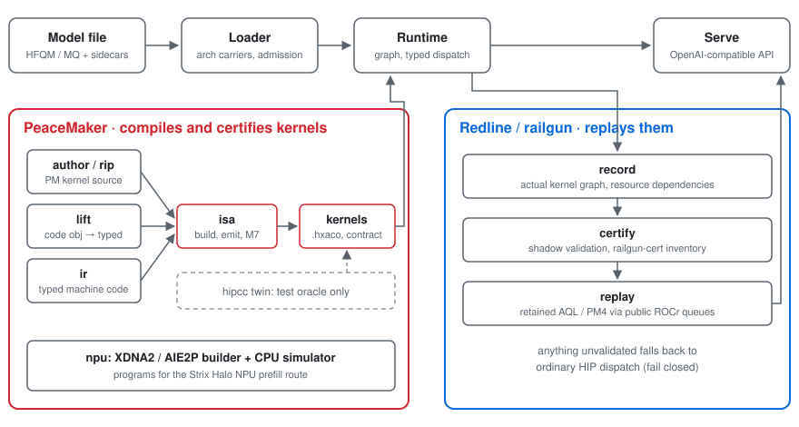

<picture>
  <source media="(prefers-color-scheme: dark)" srcset="docs/assets/hero-dark.png" />
  
</picture>

<h1 align="center">hipfire</h1>

<p align="center">
  <strong>Local LLM inference for AMD GPUs. Tuned first for RDNA, with CDNA support.</strong><br />
  Rust + HIP + Redline. No Python in the hot path. Pull, serve, chat.
</p>

<p align="center">
  <a href="https://github.com/warpfront/hipfire/releases"></a>
  <a href="CHANGELOG.md"></a>
  <a href="docs/MODELS.md"></a>
  <a href="https://discord.gg/F3BaywB8Rs"></a>
</p>

<p align="center">
  <a href="#quickstart">Quickstart</a> ·
  <a href="#whats-new-in-044">What's new</a> ·
  <a href="#measured-performance-v044">Performance</a> ·
  <a href="#models">Models</a> ·
  <a href="#gpu-support">GPU support</a> ·
  <a href="#peacemaker">PeaceMaker</a> ·
  <a href="#install">Install</a> ·
  <a href="#documentation">Docs</a>
</p>

## What hipfire is

hipfire is an inference engine for AMD GPUs. It ships its own Rust runtime,
model implementations, quantization formats (MQ3–MQ6, MQ4R, MFP4), typed
kernel dispatch and HIP kernels. ROCm is loaded dynamically. There is no
Python, PyTorch, CUDA translation layer or third-party inference engine in
the hot path.

You get a curated model registry, a CLI (`pull`, `run`, `chat`, `serve`,
`bench`, `quantize`) and an OpenAI-compatible HTTP daemon. Speculative
decoding (DFlash draft models, native MTP heads), multi-GPU expert and
tensor parallelism and the Redline replay path ship with the engine.

## Quickstart

```bash
hipfire pull qwen3.8:27b-mq4-xts
hipfire serve qwen3.8:27b-mq4-xts -d
hipfire chat qwen3.8:27b-mq4-xts
```

This downloads about 15 GB and needs a 24 GB+ card or a Strix Halo system. On
smaller cards, use `qwen3.5:4b` or `qwen3.5:9b` with the same commands.
[Pick a model for your GPU](docs/PICK-A-MODEL.md) lists recommendations for
each GPU tier.

For one-shot inference:

```bash
hipfire run qwen3.8:27b-mq4-xts "What is the capital of France?"
```

Qwen3.8-Flash (`qwen3.8:flash-next`) is a MoE model. The tag resolves to the
split base `qwen3.8-flash-next-base.mq4-xts` (about 70.9 GB), plus a shared
per-token-embedding (PLE) sidecar (29.1 GB for q4 rows, 54.4 GB for q8 rows)
and, on gfx1201, a 213 KB expert hot-set file. The old 125 GB monolith
(`qwen3.8-flash-next.mq4-xts`, formerly `qwen3.8-flash-next-gptq3.mq4`) stays
published for existing clients:

```bash
hipfire pull qwen3.8:flash-next
hipfire serve qwen3.8:flash-next -d
```

A 32 GB card alone is not enough for Qwen3.8-Flash. It needs a 128 GB Strix Halo
system, or a discrete card with enough host RAM for the mapped experts (the
0.4.4 release smoke ran it on an R9700 and on a 7900 XTX), or two R9700s
(EP2). Native context is 262K tokens, subject to available memory.

Image generation (RDNA3/3.5 measured):

```bash
hipfire pull flux.schnell:1
hipfire img --out x.png flux.schnell:1 "a red cube on a wooden table"
```

The daemon serves an OpenAI-compatible API on `127.0.0.1:11435`. It listens
on loopback only unless you set `serve.host`.

```bash
curl -s http://127.0.0.1:11435/v1/chat/completions \
  -H "Content-Type: application/json" \
  -d '{"model": "qwen3.8:27b-mq4-xts",
       "messages": [{"role": "user", "content": "What is 2+2?"}],
       "max_tokens": 256,
       "chat_template_kwargs": {"enable_thinking": false}}'
```

Qwen models think by default, and `max_tokens` counts the `<think>` span as
well as the answer. If thinking is on and the cap is small, `content` can come
back empty with `finish_reason: "length"`. Turn thinking off as shown above,
or raise `max_tokens`. Qwen3.8 and Ornith 1.5 default to `medium` reasoning
effort. See [docs/SERVE.md](docs/SERVE.md).

## What's new in 0.4.4

Every figure in this section comes from the v0.4.4 release notes and the
[CHANGELOG](CHANGELOG.md) 0.4.4 entry. Each is a measurement on one named
fixture and card, not a general throughput claim. Rows marked
contributor-measured were not re-run by the maintainers on the contributor's
card; the merge gates ran the build, the CPU tests and a smoke on a different
card. The CHANGELOG entry has the fixtures, methods, kill switches and upgrade
notes.

- **7900 XTX (gfx1100) speculative decode is faster** (two PRs and a draft
  change by @Ben1078, default on for exact gfx1100, all **NUMERIC, not
  byte-identical**). On one 7900 XTX, `qwen3.8-27b.mq4-xts`, `hipfire bench
  --spec mtp`, Q8 KV, 256 tokens, fresh-process ABBA:
  - #987, an int8-activation GEMV for 2..=5-row verify (maintainer gate):
    decode code-1k 104.7 to 127.4 tok/s (1.217x), prose-1k 106.7 to 131.1
    (1.229x), code-32k 81.8 to 95.5 (1.168x), prose-32k 51.7 to 58.9
    (1.139x). Off: `HIPFIRE_GFX1100_Q8X_VERIFY=0`.
  - #989, a WMMA split-K verify attention (standalone figures are the
    author's; stacked figures are the maintainer gate): stacked on #987,
    code 32K 95.7 to 121.2 tok/s (1.27x) and prose 32K 59.0 to 73.3 (1.24x),
    1K neutral. Off: `HIPFIRE_GFX1100_WMMA_VERIFY_ATTN=0`.
  - #998, an MTP draft over a 65,536-token vocabulary subset: a further 1.074x
    to 1.094x decode at 1K and 32K stacked on the other two, measured on the
    27B at up to 39K context only. Greedy MTP text matches beta on 3 of 4
    `mtpfloor` prompts. Off: `HIPFIRE_GFX1100_DRAFT_VOCAB=0`.
- **Dense `serve --tp N` loads the generic mesh executor by default**
  (Qwen3.5/3.6/3.8 dense, #927; `HIPFIRE_DENSE_TP_ROUTE=hand` restores the
  hand route). It runs the LM head on rank 0 only, as the hand route does.
  Maintainer-measured on 4x R9700, `qwen3.8-27b.mq4-xts`, `bench --matrix
  --spec off`, 3 fresh processes per arm, mesh vs hand route. TP2
  (2026-10-26, beta `3385df7ea5`): pp512 2,866.9 to 3,293.4 tok/s (+14.9%),
  pp2048 2,746.1 to 3,358.5 (+22.3%), and decode matches the hand route
  (54.89 vs 54.95 tok/s at 128 context, 54.19 vs 54.24 at 4K). TP4
  (2026-10-26, the #927 pre-land build, before the rank-0 LM head): pp512
  1,919.4 to 2,061.0 (+7.4%), pp2048 1,997.4 to 2,113.4 (+5.8%), decode
  43.96 to 51.77 tok/s (+17.8%) at 128 context. TP2 prompts of 16 and 32
  tokens prefill 2.5% to 3.3% slower than on the hand route (pp16 479.6 vs
  496.2 tok/s). `speculation.mtp = on` and uneven TP3/TP5 splits still take
  the hand route.
- **Vision is on by default with a streamed tower.** `vision_mode` now
  defaults to `auto`: a present vision sidecar is loaded and the
  Qwen3.5/3.8-VL tower streams from host per block, so a vision load costs
  about 128-142 MiB of idle VRAM instead of about 0.94 GiB
  (`vision_mode=resident` keeps the whole-tower upload; `hipfire config set
  vision_mode off` restores the text-only load). Image turns prefill in
  batched chunks: on the R9700 (`qwen3.8-27b.mq4-xts` + vision, 1024x1024,
  HTTP TTFT, greedy) TTFT goes from 37.3 s to 0.51 s. Streamed-tower TTFT is
  0.81 s on the 7900 XTX and 1.84 s on Strix Halo. Batched image prefill is
  numeric; the tower GEMM is bit-identical and the streamed embeddings are
  byte-identical to the resident path on gfx1201.
- **LLaMA-arch models prefill in batched chunks** (LLaMA, Mistral, SmolLM2,
  #982), **numeric rather than byte-identical**
  (`HIPFIRE_PREFILL_BATCHED=0` restores per-token). Maintainer gate:
  SmolLM2-360M mq4v1 on gfx1201, 148 to 3,705 tok/s at 1,169 tokens;
  Llama-3.2-1B HFQ4G256 on a 7900 XTX (gfx1100), 463 to 8,130 tok/s. A
  head_dim-64 Q8 flash decode tile (#978, also numeric) removes the decode
  fall-off with context for SmolLM2 and Llama-3.2-1B. MQ4G256V2 (`.mq4`)
  LLaMA-arch files still prefill per token.
- **Strix Halo (gfx1151) wave** (@fivetide, @HUSRCF). Contributor-measured on
  Strix Halo: Qwen3-8B (`qwen3-8b.mq4`, 7,741-token prompt) DFlash prefill
  538 s to 13.1 s and decode 7.4 to 20.8 tok/s (#958); 9B DFlash 2K 45.7 to
  59.6 tok/s and 4K 36.0 to 56.5, byte-identical to the previous build (#961,
  #962, shared box, indicative). Flash-Next prefill gains
  (persistent HC-up v2, fused HC-down, one-pass MoE front) are
  byte-identical by GPU oracle, default on, with kill switches in the
  CHANGELOG. Qwen3-8B DFlash stays slower than AR at tau 0.2-0.8, so AR
  remains the faster choice there. A Flash-Next reload is no longer refused
  for RAM left in the TTM page pool, and `hipfire pull` no longer downloads
  the 305.5 MB trunk overlay on a host that will not apply it.
- **Flash-Next on the R9700: decode-share is on by default** (admitted loads
  only; byte-identical; `HIPFIRE_QWEN4_DECODE_SHARE=off` disables it). One
  R9700, 3 rounds of fresh processes per arm: MTP decode 61.82 vs 51.14 tok/s
  with it off (+20.9%), pp16384 6,677.5 vs 6,686.7 (-0.1%). The second token
  after a 16K prompt takes 78.7 ms instead of 22.7 ms. The 0.4.3 Flash-Next
  defaults (16,384-row chunk, hot set) are unchanged. On one R9700 (split
  base, 3 fresh processes per arm, 2026-10-26) the hot set makes `--spec
  auto` decode on real text 34% to 50% faster than
  `HIPFIRE_QWEN4_EXPERT_HOTSET=0` (prose 49.7 vs 37.2 tok/s, code 80.6 vs
  55.2 and 78.6 vs 52.4) at equal pp16384 (6,648 vs 6,646 tok/s); it costs
  4.2% at pp512 and 4.8% on synthetic random-id tg128. Against
  `HIPFIRE_PREFILL_CHUNK_ROWS=4096`, the 16,384-row chunk is 25.7% faster at
  pp16384 (6,648 vs 5,288 tok/s) and 1.9% to 3.7% slower on real-text
  `--spec auto` decode, so a 4,096-row chunk only helps decode-bound
  workloads with short prompts.
- **Long-context DFlash on the R9700: the native-fp8 split-KV verifier is
  default on for exact gfx1201** (#921, #922, @paleluna82-del; 27B-class
  H24/KV4/D256, fp8 KV, live context at or above 8,192, at most 16 verify
  rows; `HIPFIRE_GFX12_FA2_SPLIT_VERIFY_FP8=0` turns it off).
  Maintainer-measured on one R9700, 27B mq4-xts with the registry DFlash
  draft, median over 3 fresh processes per arm: decode 16K 53.30 to 59.60
  tok/s (+11.8%), 32K 40.40 to 51.40 (+27.2%), 64K 29.93 to 43.37 (+44.9%),
  128K 18.93 to 33.70 (+78.0%); 4K is unchanged within noise. **NUMERIC, not
  byte-identical** (coherent output).

Upgrade notes: greedy text can differ from 0.4.3.1 at near-ties because of
the numeric changes above. Registry sampling for the Qwen3.5 and
Qwen3.6-35B-A3B tags now defaults to `presence_penalty 0.0` (was 1.5). The
rest of the upgrade notes and known issues are in the
[CHANGELOG](CHANGELOG.md).

## Measured performance (v0.4.4)

Each row is one measurement on the named date, fixture, card and build, in
the claim language of [BENCHMARKS.md](docs/BENCHMARKS.md). None is a speed
floor, a product admission or a guarantee for other prompts, contexts or
hosts. Decode is tok/s per request; prefill is prompt tok/s. The source in
each row has the method; the [CHANGELOG](CHANGELOG.md) has the history.

| Card | Model and route | Fixture and method | Result | Date, build | Source |
|---|---|---|---|---|---|
| R9700 | `qwen3.8-27b.mq4-xts`: AR (`--spec off`), native MTP head (`--spec mtp`), registry DFlash draft (`--spec dflash`) | committed prompts `humaneval_0_has_close_elements.txt` (code, 134 tokens) and `fiction_lighthouse.txt` (prose, 44 tokens), `bench --runs 5 --warmups 3 --backend noslots --workload stateless`, 128 tokens, 3 fresh processes x 5 runs (median of 15) | decode AR 41.2 (code and prose); DFlash 313.6 (code), 63.4 (prose); MTP 95.0 (code), 55.5 (prose) | 2026-10-27, published v0.4.4 gfx1201 binary archive (tag `75c28fc064`) | v0.4.4 release-binary bench |
| R9700 | `qwen3.8-27b.mq4-xts`, AR, fp8 KV | `bench --matrix --spec off --pp 512,2048,16384`, 3 fresh processes x 5 runs | prefill 4,936 (pp512), 5,278 (pp2048), 4,888 (pp16384) | 2026-10-27, published v0.4.4 gfx1201 binary archive | v0.4.4 release-binary bench |
| R9700 | `qwen3.8-27b.mq4-xts` + registry DFlash draft, fp8 KV, native-fp8 split-KV verifier (default) | serve battery long turns, 1,024 max tokens, 3 fresh processes per arm | decode 59.60 (16K), 51.40 (32K), 43.37 (64K), 33.70 (128K) | 2026-10-26, 0.4.4 cycle beta | CHANGELOG 0.4.4 (#921, #922) |
| 7900 XTX | `qwen3.8-27b.mq4-xts` + native MTP, Q8 KV (#987 + #989 + #998) | committed `mtpfloor` prompts, `bench --spec mtp`, 256 tokens, fresh-process ABBA | decode 136.5-136.8 (code 1K), 141.1 (prose 1K), 129.5-129.9 (code 32K), 79.7-80.1 (prose 32K) | 2026-10-26, beta `085dd189b5` + #998 | #998 merge gate (speedups in release notes 0.4.4) |
| Strix Halo | `qwen3.8-27b.mq4-xts` + paired DFlash draft | committed `merge_sort_thinking_off` code prompt, `bench`, 256 tokens, 3 fresh processes | decode 135.3 | 2026-10-13, v0.4.2 (not re-measured on 0.4.4) | CHANGELOG 0.4.2 |
| R9700 | `qwen3.8-flash-next-gptq3.mq4` (monolith, q4 PLE), native MTP, decode-share | 11-prompt MTP suite and `bench --matrix`, 3 rounds of fresh processes | decode 61.82 (MTP suite); pp16384 6,677.5 | 2026-10-27, v0.4.4 RC2 (`125b2b5ca9`) | release notes 0.4.4 |
| R9700 | `qwen3.8-flash-next-base.mq4-xts` (split base, the `qwen3.8:flash-next` pull), hot set, q4 PLE rows: AR (`--spec off`) and native MTP (`--spec mtp`, which runs MTP + n-gram) | committed prompts `humaneval_0_has_close_elements.txt` (code) and `fiction_lighthouse.txt` (prose), `bench --runs 5 --warmups 3`, 640 tokens, 3 fresh processes x 5 runs; pp16384 from `bench --matrix --spec off` | decode AR 49.7 (code), 45.6 (prose); MTP 82.9 (code), 48.5 (prose); prefill 6,647.8 (pp16384) | 2026-10-27, published v0.4.4 gfx1201 binary archive | v0.4.4 release-binary bench |
| Strix Halo + XDNA2 | `qwen3.8-flash-next-gptq3.mq4` (monolith, q4 PLE, trunk overlay, NPU trunk `auto`) | 16,355-token prompt, cold serve TTFT, 3 fresh processes x 3 requests | prefill 2,472.7 (TTFT 6.61 s) | 2026-10-27, v0.4.4 release head `943b5323da` | v0.4.4 Halo 16K release gate |
| R9700 | `qwen3.6:35b-a3b-mq4rs`, AR | `bench --matrix --spec off --pp 512,4096,16384 --tg 128 --ctx 128`, 3 fresh processes x 5 runs | prefill 11,788 (pp512), 19,867 (pp4096), 18,567 (pp16384); decode 242.2 (tg128 at 128 context) | 2026-10-27, published v0.4.4 gfx1201 binary archive | v0.4.4 release-binary bench |
| 2x / 4x R9700 | `qwen3.8-27b.mq4-xts`, dense TP on the mesh route | `bench --matrix --spec off`, 3 fresh processes | TP2 pp2048 3,358.5, decode 54.89; TP4 pp2048 2,113.4, decode 51.77 (128 context) | 2026-10-26; TP2 beta `3385df7ea5`, TP4 the #927 pre-land build | release notes 0.4.4, [multi-gpu.md](docs/multi-gpu.md) |

`qwen3.6:35b-a3b-mq4rs` loads on gfx1201 only; see
[MODELS.md](docs/MODELS.md). Flash-Next on a 24 GB card (7900 XTX) runs with
host-mapped experts, so its speed depends on the host link; no v0.4.4
measurement of it is listed here. Earlier releases, including the 0.4.2
expert parallelism (EP2 to EP8), the Strix Halo NPU prefill route,
engine-level YaRN and the 0.4.3 `mq4rs` quant, are described in the
[CHANGELOG](CHANGELOG.md).

[BENCHMARKS.md](docs/BENCHMARKS.md) explains fixture identity and the
requirements for admitting a measurement. Its older tables are historical,
not current product baselines.

## Models

The bundled registry (`registry/v1.json`) contains 94 curated entries
(models, quant variants and draft sidecars) and 85 aliases. Run
`hipfire list -r` for the live list.

| Family | Pull tags |
|---|---|
| Qwen 3.8 dense | `qwen3.8:27b` (MQ4V2 default), `qwen3.8:27b-mq4-xts` (flagship), `-mq4-xt`, `-mq4-pro`; MQ3, MQ5 and MQ6 `-xt` / base / `-pro` tiers; drafts `qwen3.8:27b-draft-mq3` … `-mq6` |
| Qwen 3.8 Flash | `qwen3.8:flash-next` (alias `qwen3.8:flash`; MQ4 XTS split base), `-mq3-xts`, `-mq2-xts`, `-mq2-xts-4500` |
| Qwen 3.6 35B-A3B | `qwen3.6:35b-a3b` (MQ4P default), `-mq2`, `-mq3p`, `-mq4p`, `-mfp4`, `-mq4r`, `-mq4rs` (symmetric experts, gfx1201 fast prefill), `-mq5`, `-mq6` |
| Qwen 3.6 dense | `qwen3.6:27b`, `qwen3.6:27b-mq3`, drafts `qwen3.6:27b-draft`, `-draft-mq3` |
| Qwen 3.5 dense | `qwen3.5:0.8b`, `2b`, `4b`, `9b`, `27b`, with `-mq3` / `-mq6` variants and `9b` / `27b` drafts |
| Qwen 3.5 MoE | `qwen3.5:35b-a3b` |
| Qwen3 | `qwen3:0.6b`, `qwen3:8b` |
| Muse Glimmer | `muse-glimmer`, `muse-glimmer:fast` (MQ4R), `muse-glimmer:draft` |
| Ornith 1.5 | `ornith-1.5:35b-a3b`, `ornith-1.5:fast` (MQ4R) |
| DeepSeek V4 Flash | `deepseek-v4-flash` |
| MiniMax-M2.7 | `minimax-m2.7` |
| North-Mini-Code-1.0 | `north-mini-code` |
| Carnice (Hermes tool calls) | `carnice:9b`, `carnice:27b`, `-mq6` variants |
| Qwopus | `qwopus:4b`, `9b`, `27b`, `-mq6` variants, `qwopus3.6:27b-coder` |
| LFM2.5 | `lfm2.5:350m`, `1.2b`, `1.2b-thinking`, `8b-a1b` |
| NEX N2 Mini | `nex-n2:mini` |
| VibeThinker | `vibethinker:3b`, `vibethinker:3b-mq6` |
| FLUX (image) | `flux.schnell:1` and others in [IMAGEGEN.md](docs/IMAGEGEN.md) |

Curated weights are published under
[huggingface.co/hipfire-models](https://huggingface.co/hipfire-models).
[docs/MODELS.md](docs/MODELS.md) covers sizes, minimum VRAM, sampling
defaults, sidecars and provenance. To bring your own model, use
`hipfire quantize`.

### Qwen 3.8 Flash Next split-PLE tiers (0.4.3)

The `hipfire-models/qwen3.8-flash-next` repository publishes three plain
split-PLE trunk files at its root, next to the shared PLE sidecar. The sizes
below are **file sizes in bytes, not VRAM or peak-memory requirements**.
Publishing a file is not a claim that every GPU route or speed has been
measured on it.
The [published model card](https://huggingface.co/hipfire-models/qwen3.8-flash-next/blob/fc845731a50018daf1eb43ad2619ca2cdd75c0ee/README.md#measurement-boundary-for-the-new-hashes)
records the receipt-backed measurements and their acceptance scope.

| Tier | File (HF link) | Bytes | SHA-256 |
|---|---|---:|---|
| MQ3 | [`qwen3.8-flash-next-base.mq3-xts`](https://huggingface.co/hipfire-models/qwen3.8-flash-next/blob/main/qwen3.8-flash-next-base.mq3-xts) | 59109362200 | `d35896ca69b87d3e93176847a036db3e2cb1554931f130a842b13718b486238b` |
| MQ2 (6,306 hot) | [`qwen3.8-flash-next-base.mq2-xts`](https://huggingface.co/hipfire-models/qwen3.8-flash-next/blob/main/qwen3.8-flash-next-base.mq2-xts) | 46895167000 | `e2ba747485190da92cd7a36d3f56809e6db31a3ec328f5ab23e000275d798e57` |
| MQ2 (4,500 hot) | [`qwen3.8-flash-next-base.mq2-xts-4500`](https://huggingface.co/hipfire-models/qwen3.8-flash-next/blob/main/qwen3.8-flash-next-base.mq2-xts-4500) | 44537253400 | `9087d7d8f67629a3256c26bfeb705e7ed22dd1622bb91e074035543d6caea5c2` |
| Shared PLE sidecar (Q4) | [`qwen3.8-flash-next.ple-q4`](https://huggingface.co/hipfire-models/qwen3.8-flash-next/blob/main/qwen3.8-flash-next.ple-q4) | 29120146432 | `fc78d30b9d2376db2b713732e80de2069f1cd1d6e1e40b50c716927dcc18ee1e` |

Trunk plus the Q4 sidecar totals 88,229,508,632 (MQ3), 76,015,313,432 (MQ2
6,306) and 73,657,399,832 (MQ2 4,500) bytes on disk. The MQ2 tiers need
hipfire at or after `ea2abd111f06339e9f25ac86715b7d210d0c5ae8`; the MQ3 tier
needs `ca0aee9c925b4180651b194b440bcda80f656ac5`.

**MQ2 KLD on an RX 7900 XTX (gfx1100), post-land.** Mean KLD against the FP8
reference, hipfire `ea2abd111f06339e9f25ac86715b7d210d0c5ae8`, with the
shipping MQ2 hashes above. WikiText-2 (`wt2`): 32 chunks, 8160 scored rows;
`code24`: 24 chunks, 6120 scored rows. Pre-land references describe earlier
d2 predecessor bytes, not fresh measurements of the published roots; decode
rows are paired against the weight-only reference and prefill rows against
the prefill reference. The pre-land
decode references (MQ2 6,306: 0.1851 wt2 / 0.1981 code24; MQ2 4,500: 0.2078 /
0.2077) are weight-only model KLD, not GPU route measurements; the XTX
columns are GPU route measurements.

| Tier | Corpus | Route | Pre-land reference | XTX post-land | Paired Δ (95% CI) | Relative Δ | Status |
|---|---|---|---:|---:|---|---:|---|
| MQ2 6,306 | wt2 | decode | 0.1851 | 0.1966 | +0.0115 (+0.0075, +0.0155) | +6.23% | accepted by Kaden exact-row exception |
| MQ2 6,306 | code24 | decode | 0.1981 | 0.2083 | +0.0103 (+0.0018, +0.0160) | +5.18% | accepted, relative budget |
| MQ2 6,306 | wt2 | prefill | 0.2095 | 0.2106 | +0.0011 (−0.0058, +0.0080) | +0.55% | accepted, not significant |
| MQ2 6,306 | code24 | prefill | 0.2111 | 0.2112 | +0.0001 (−0.0059, +0.0068) | +0.05% | accepted, not significant |
| MQ2 4,500 | wt2 | decode | 0.2078 | not re-measured (identity + G2 pass) | — | — | not re-measured (identity + G2 pass) |
| MQ2 4,500 | code24 | decode | 0.2077 | 0.2192 | +0.0116 (+0.0053, +0.0179) | +5.56% | accepted, relative budget |
| MQ2 4,500 | wt2 | prefill | 0.2274 | 0.2291 | +0.0017 (−0.0055, +0.0091) | +0.76% | accepted, not significant |
| MQ2 4,500 | code24 | prefill | 0.2237 | not re-measured (identity + G2 pass) | — | — | not re-measured (identity + G2 pass) |

Six of the eight cells were measured on the XTX. The MQ2 6,306 wt2 decode row
(0.1966, +6.23%) exceeds the 6% relative budget and is accepted only as an
explicit exact-row exception by Kaden; it is not a budget pass. The two
remaining MQ2 4,500 cells were not re-measured. Product identity compared
the builds on earlier d2 bytes (32 identical greedy token ids); G2 AR-lane
parity passed on the published root hashes. Neither is a KLD measurement.
This is not an
all-eight-measured result. MQ3 XTX evidence is refusal-only; no XTX KLD or
speed measurement is claimed.

## GPU support

| Family | Architectures | Notes |
|---|---|---|
| Vega / CDNA | `gfx906`, `gfx908`, `gfx940`–`gfx942` | Wave64 HIP; gfx906 dp4a MMQ prefill; some formats use a per-token GEMV fallback |
| RDNA1 | `gfx1010`–`gfx1013` | Portable HIP and Redline dispatch; MQ6/HFQ6 GEMV admitted in 0.4.4 (#478; resolve-tested on CPU, not on RDNA1 hardware) |
| RDNA2 | `gfx1030`–`gfx1032` | Portable HIP and Redline dispatch; MQ6/HFQ6 GEMV admitted in 0.4.4 (#478; resolve-tested on CPU, so the load still warns "UNVALIDATED on RDNA2") |
| RDNA3 | `gfx1100`–`gfx1103` | WMMA kernels, validated MQ4R Redline route; gfx1100 int8 MTP verify GEMV, WMMA verify attention and MTP draft vocabulary (default on) |
| RDNA3.5 | `gfx1150`–`gfx1152` | WMMA kernels; Strix Halo (gfx1151) XDNA2 NPU prefill route |
| RDNA4 | `gfx1200`, `gfx1201` | WMMA kernels, retained-PM4 Redline route, native-fp8 split-KV DFlash verify, opt-in EP2-EP8 expert parallelism, dense TP2/TP4 |

<picture>
  <source media="(prefers-color-scheme: dark)" srcset="docs/assets/readme/gpu-matrix-dark.svg" />
  
</picture>

Kernels are chosen through typed per-architecture dispatch tables. A
specialization that is not available falls back to the portable or
architecture fallback kernel. It is never borrowed from a neighbouring GPU
family. Support for a GPU family does not mean every optimized route is
admitted on it.

## Redline

Redline is hipfire's in-tree dispatch and retained-replay layer. It records
the actual kernel graph, derives resource dependencies, retains invariant
command state, and lowers validated paths through public ROCr queue
interfaces. If a graph is unsupported, shadow validation fails, the ABI does
not match, a queue faults or the model changes, Redline falls back to
ordinary HIP dispatch.

<picture>
  <source media="(prefers-color-scheme: dark)" srcset="docs/assets/readme/architecture-dark.svg" />
  
</picture>

The [Golden Redline guide](docs/GOLDEN-REDLINE.md) reproduces the sealed
MQ4R fixture (`python3 -m tools.redline golden`). Historical MQ4R
measurements are in the
[gfx1201 campaign report](docs/perf-checkpoints/2026-07-13-redline-mq4r-110-to-204.md).
For the integration boundary, see
[HIPFIRE-GRAFT.md](crates/redline-dispatch/HIPFIRE-GRAFT.md).

## PeaceMaker

PeaceMaker is hipfire's own kernel toolchain. It builds AMD GPU and XDNA2
NPU programs directly, without hipcc. It works on typed machine code, and it
can lift existing code objects so they can be checked against what
PeaceMaker emits. It has six crates:

| Crate | Role |
|---|---|
| `peacemaker-ir` | Typed RDNA machine-code representation and instruction tables |
| `peacemaker-lift` | Lifter for ELF, offload bundles, descriptors and metadata. Decoded kernels are re-encoded from typed fields and compared word for word |
| `peacemaker-isa` | Kernel builder and emitter (`peacemaker-isa` binary), with region import, wait-ledger checks and certification |
| `peacemaker-author` | PM kernel language (milestone M0, experimental, build-time only) |
| `peacemaker-rip` | Standalone `.rip` front end that lowers Rust-shaped kernel scripts onto the builder, without rustc |
| `peacemaker-npu` | XDNA2 / AIE2P program builder: encoder/scheduler, CDO/PDI and DPU transaction writers, CPU simulator |

Since 0.4.2, more production routes run builder-emitted, M7-certified
PeaceMaker kernels. These ship as embedded `kernels/*.hxaco` modules with
shape contracts. The hipcc versions of those kernels are kept only as oracle
twins for exactness tests, not as runtime fallbacks. Examples from the
[CHANGELOG](CHANGELOG.md):

- sampled DFlash device acceptance on gfx1201
- CPU-AR sampled target rows and ordered acceptance on gfx1151 and gfx1201
- Qwen3.8-Flash EP owner assignment on gfx1201
- the gfx1151 MTP prompt-fill projections

The Strix Halo NPU prefill route builds its programs with `peacemaker-npu`.
The offline `railgun-cert` recording-inventory gate keeps the list of
recording and capture predicates in sync with the source tree. A kernel
route with a certified PeaceMaker kernel is still subject to hipfire's
normal admission and validation gates.

PeaceMaker is also published as a standalone repository,
[github.com/warpfront/peacemaker](https://github.com/warpfront/peacemaker).
`scripts/mirror-push.sh peacemaker` builds a history-preserving split of
the PeaceMaker crates and their path dependencies. It then checks that the
split builds and tests on its own, checks author identities and runs the
publication guard on every commit. Only then does it push to `main`. Like
hipfire, PeaceMaker is Apache-2.0. Some files remain MIT under their
per-file SPDX header, and the mirror's LICENSE adds the LLVM exception
notice (see `scripts/mirror_split.py`).

## Install

Linux with ROCm 6 or newer:

```bash
curl -fsSL https://raw.githubusercontent.com/warpfront/hipfire/v0.4.4/scripts/install.sh | bash

# Or install the integration branch for testing:
curl -fsSL https://raw.githubusercontent.com/warpfront/hipfire/v0.4.4/scripts/install.sh \
  | bash -s -- --branch beta
```

RDNA4 requires ROCm 6.4 or newer, and gfx1151 requires ROCm 7.2 or newer.
Release-tag installs download a verified prebuilt kernel pack for the
detected arch when one is available. Otherwise they build kernels locally
with hipcc. See
[Prebuilt kernel packs](docs/GETTING_STARTED.md#prebuilt-kernel-packs).

Before the first pull, `hipfire doctor` checks the driver and ROCm install, and
`hipfire fit <model> --ctx N` says whether that model loads at that context on
this machine, what the load would choose, and what to change if it does not.

`hipfire version` compares the installed binary, the managed source checkout
and the daemon. To switch revisions, use `hipfire update @beta`,
`hipfire update --tag <tag>` or `hipfire update --commit <sha>`. To
uninstall while keeping models and settings:

```bash
curl -fsSL https://raw.githubusercontent.com/warpfront/hipfire/v0.4.4/scripts/uninstall.sh | bash
```

`--dry-run` previews the uninstall. `--purge` also deletes `~/.hipfire` and
asks for confirmation first.

Native Windows and WSL2 are untested on GPU hardware; install notes, limits, and
how to help test (`scripts/windows-check.ps1`) are in
[docs/GETTING_STARTED.md](docs/GETTING_STARTED.md#help-test-windows). NixOS has
a flake and a module ([docs/NIXOS.md](docs/NIXOS.md)):

```bash
nix develop github:warpfront/hipfire  # dev shell with Rust + ROCm
nix build github:warpfront/hipfire    # build package
```

Containers ([docs/CONTAINER.md](docs/CONTAINER.md)):

```bash
docker compose up -d      # or: podman compose up -d
curl http://127.0.0.1:11435/v1/models
```

The image is `ghcr.io/warpfront/hipfire:latest` (`docker pull
ghcr.io/warpfront/hipfire:0.4.4`); `HIPFIRE_IMAGE=ghcr.io/warpfront/hipfire:0.4.4`
pins compose to a release.

## Deprecated features

PFlash prefill compression, CASK / TriAttention KV eviction,
Givens/asymmetric KV modes and the legacy DFlash knobs have been deprecated
since 0.4.0. They are unsupported and will be removed in 0.5.0. See
[configuration](docs/CONFIG.md) for supported settings and
[validation](docs/VALIDATION.md) for the current gates.

## Documentation

| Page | Topic |
|---|---|
| [GETTING_STARTED.md](docs/GETTING_STARTED.md) | Install, first run, what to read next |
| [PICK-A-MODEL.md](docs/PICK-A-MODEL.md) | Model recommendations by GPU tier |
| [CLI.md](docs/CLI.md) | Every subcommand, flags, file locations |
| [MODELS.md](docs/MODELS.md) | Curated tags, BYO models, file extensions |
| [QUANTIZE.md](docs/QUANTIZE.md) | `hipfire quantize` for HF / safetensors |
| [CONFIG.md](docs/CONFIG.md) | Every config key and env override |
| [SERVE.md](docs/SERVE.md) | OpenAI-compatible HTTP API |
| [multi-gpu.md](docs/multi-gpu.md) | EP, TP and pipeline parallelism; budgets and refusals |
| [IMAGEGEN.md](docs/IMAGEGEN.md) | FLUX image generation |
| [ARCHITECTURE.md](docs/ARCHITECTURE.md) | Engine layout and dispatch |
| [QUANTIZATION.md](docs/QUANTIZATION.md) | MQ formats, KV cache modes, FWHT |
| [BENCHMARKS.md](docs/BENCHMARKS.md) | Admitted measurements and claim requirements |
| [VALIDATION.md](docs/VALIDATION.md) | Correctness and speed gates |
| [methodology/perf-benchmarking.md](docs/methodology/perf-benchmarking.md) | Benchmark protocol |
| [peacemaker-isa map](crates/peacemaker-isa/map.md) / [peacemaker-author map](crates/peacemaker-author/map.md) | PeaceMaker builder and kernel language |
| [npu/README.md](docs/npu/README.md) / [peacemaker-npu map](crates/peacemaker-npu/map.md) | XDNA2 NPU builder, simulator and tools |
| [NIXOS.md](docs/NIXOS.md) / [CONTAINER.md](docs/CONTAINER.md) | NixOS and container builds |

## Contributing

See [CONTRIBUTING.md](CONTRIBUTING.md), including the
[release cadence and PR cutoff](CONTRIBUTING.md#release-cadence-and-pr-cutoff).
Install local hooks with `./scripts/install-hooks.sh`.
`./scripts/no-gpu-ci.sh` runs the no-GPU CI subset, but it does not replace
the hardware gates. No single gate establishes correctness on its own.
Choose the route your change needs from
[docs/VALIDATION.md](docs/VALIDATION.md):

- `scripts/serve_harness.py` for generation and state-lifecycle changes.
- `scripts/redline_daemon_harness.py` for kernel, dispatch, graph or replay
  changes.

Do not bypass hooks with `--no-verify`.

Discord: <https://discord.gg/F3BaywB8Rs>

## Acknowledgements

hipfire's gfx906 MMQ prefill path follows the design of the MMQ kernels in
upstream [llama.cpp](https://github.com/ggml-org/llama.cpp). The
community-maintained gfx906 forks of llama.cpp also informed that work.
[CREDITS.md](CREDITS.md) lists contributors.

## License

hipfire is licensed under **Apache-2.0** as of v0.3.0. See
[LICENSE](LICENSE), [LICENSE-APACHE](LICENSE-APACHE) and [NOTICE](NOTICE).
Releases up to and including v0.2.1 were dual MIT/Apache-2.0, and that grant
is not revoked. Files whose authors have not elected Apache-2.0 remain MIT
([LICENSE-MIT](LICENSE-MIT)) and say so in their `SPDX-License-Identifier`.
The decision record is
[docs/governance/relicense-2026-05.md](docs/governance/relicense-2026-05.md).
Architectural work that originated in hipfire is catalogued in
[PRIOR-ART.md](PRIOR-ART.md). Derivative works should attribute it as
described in [AGENTS.md](AGENTS.md).
